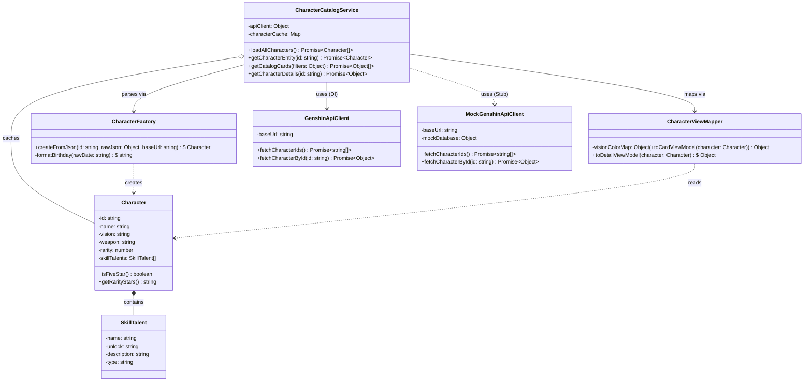

# Design Document: Каталог персонажів (Character Catalog)

## 1. Архітектура шару бізнес-логіки (Core Layer)

Бізнес-логіка додатку «Каталог персонажів» спроєктована відповідно до тришарової архітектури. Це забезпечує повну ізоляцію ядра системи (`CORE`) від шару представлення (`GUI`/`CLI`) та шару отримання даних (`DATA`).

### Використані патерни та класи

1. **Domain Model (`Character`, `SkillTalent`):** класи предметної області, які інкапсулюють властивості персонажа за допомогою приватних полів (`#`) та надають методи для роботи з бізнес-правилами (перевірка рідкості `isFiveStar()`, форматування рейтингу `getRarityStars()`).
2. **Factory (`CharacterFactory`):** інкапсулює логіку парсингу вхідного JSON із зовнішнього API (`https://jmp.blue`), проводить нормалізацію даних (очищення формату дати народження, генерація посилань на медіаресурси) та підстановку значень за замовчуванням.
3. **Mapper / ViewModel (`CharacterViewMapper`):** перетворює доменні сутності на плоскі об'єкти (`CardViewModel` та `DetailViewModel`), оптимізовані для рендерингу в компоненті графічного інтерфейсу (включаючи мапінг кольорових тем стихій).
4. **Service & Dependency Injection (`CharacterCatalogService`):** центральний фасад бізнес-логіки, який реалізує кешування завантажених моделей, фільтрацію (за елементом, типом зброї, рідкістю, пошуковим запитом) та сортування. Клас не залежить від конкретної реалізації мережевих запитів, що дозволяє підключати як реальний `GenshinApiClient`, так і тестову заглушку `MockGenshinApiClient`.

## 2. Діаграма класів (UML)

## 3. Шар постійності інформації (Persistence Layer / DATA)

Для зменшення кількості мережевих запитів до зовнішнього API та забезпечення збереження даних між запусками додатку в проєкті реалізовано систему локальної буферизації графічних ресурсів (портретів персонажів).

### Архітектурні рішення
1. **Клас `LocalImageCacheRepository` (`src/infrastructure/LocalImageCacheRepository.js`):** інкапсулює роботу з локальною файловою системою (модуль `node:fs/promises`). Клас ізольований від бізнес-логіки та підключається до `CharacterCatalogService` через механізм ін'єкції залежностей (Dependency Injection).
2. **Місце зберігання даних:** відповідно до рекомендацій щодо проєктування програмного забезпечення, кешовані файли зберігаються не в робочій папці з вихідним кодом, а в системній директорії профілю користувача (`~/.genshin-character-catalog/cache/images/`). Це запобігає засміченню робочої директорії та гарантує збереження буфера між перезапусками програми.
3. **Алгоритм буферизації:**
   * Перед зверненням до мережі метод `getOrDownloadImage()` перевіряє наявність локального файлу на диску (`hasCachedImage()`).
   * Якщо файл існує, система повертає його локальний шлях зі статусом `DISK_CACHE`, повністю уникаючи мережевого запиту.
   * Якщо файл відсутній, завантажуються бінарні дані зображення (`ArrayBuffer` -> `Buffer`) та записуються у локальний `.png` файл (із передбаченим резервним механізмом `LOCAL_FALLBACK` на випадок недоступності зовнішнього сервера).
## 4. Шар представлення та клієнт-серверна взаємодія (Presentation Layer / GUI)

Відповідно до технічного завдання обрано альтернативний підхід побудови графічного інтерфейсу у вигляді вебзастосунку на базі бібліотеки **React (JavaScript)** із проміжним шаром **Web-API на Express.js**. Це дозволяє зберегти повну ізоляцію існуючого ядра бізнес-логіки (`CORE`) та шару постійності (`DATA`), надаючи користувачу повноцінний віконний інтерфейс у браузері.

### Архітектура взаємодії (Client-Server)
1. **Web-API (`server.js` на Express.js):** виступає адаптером між HTTP-запитами клієнта та фасадом `CharacterCatalogService`.
   * `GET /api/characters` — приймає параметри фільтрації (`search`, `vision`, `weapon`, `rarity`), викликає `getCatalogCards()` та ініціює локальну буферизацію портретів через `bufferCharacterPortrait()`.
   * `GET /api/characters/:id` — повертає повну модель `DetailViewModel` через `getCharacterDetails()` разом із локально закешованим портретом.
   * Статичний маршрут `/cached-images` роздає буферизовані портрети безпосередньо з локальної директорії `LocalImageCacheRepository`.
2. **Ієрархія компонентів (GUI Tree Structure):**
   * `App` (кореневий контейнер вікна) містить панель керування фільтрами (`input`, `select`, `button`) та прокручуваний контейнер (`catalog-scroll-container`).
   * `CharacterCard` — композитний елемент інтерфейсу, який інкапсулює відображення портрета (`img`), імені, титулу, стихії та рівня рідкості.
   * `CharacterModal` — модальне вікно для відображення розширених даних персонажа (`DetailViewModel`) та статусу джерела зображення (`DISK_CACHE` / `NETWORK`).
3. **Модель функціонування GUI:**
   * Використано **Event-driven підхід** (реакція на події `onChange` у полях пошуку/фільтрації та `onClick` на картках персонажів) у поєднанні з реактивним оновленням стану (`useState`, `useEffect`) та готовими об'єктами представлення (`CardViewModel`, `DetailViewModel`), сформованими класом `CharacterViewMapper`.
